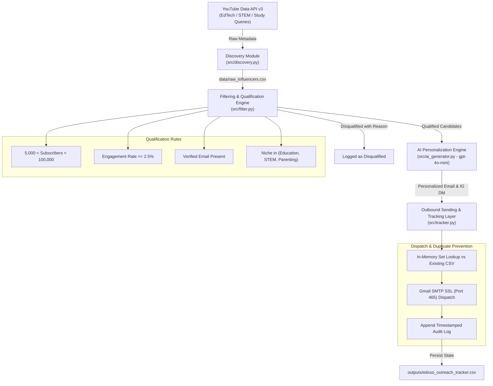
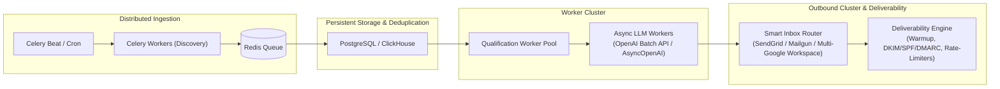

# 🎓 EDXSO Automated Micro-Influencer Outreach System

> **Production-Ready AI-Driven Creator Discovery, Qualification, Personalization, and Outbound Dispatch Pipeline.**

---

## 📌 Executive Summary

**EDXSO** is an innovative digital learning and educational technology platform. To scale customer acquisition cost-effectively, this system automates end-to-end micro-influencer discovery, qualification, AI-personalized copy generation, and outbound dispatch with built-in duplicate prevention.

---

## 🏗️ System Architecture Flow



---

## 📂 Project Structure

```text
EDXSO/
├── .env.example                     # Environment variables template
├── .gitignore                       # Ignored artifacts, virtual envs, and data
├── requirements.txt                 # Pinned dependencies
├── main.py                          # End-to-end pipeline orchestrator
├── data/
│   ├── .gitkeep
│   └── raw_influencers.csv          # Raw YouTube discovery data
├── outputs/
│   └── edxso_outreach_tracker.csv   # Sent & tracking audit database
├── src/
│   ├── __init__.py
│   ├── discovery.py                 # YouTube Data API discovery & metric extraction
│   ├── filter.py                    # Multi-criteria business logic & qualification
│   ├── ai_generator.py              # OpenAI gpt-4o-mini structured JSON outreach generator
│   └── tracker.py                   # Duplicate prevention & Gmail SSL SMTP dispatch
└── tests/
    ├── __init__.py
    ├── test_discovery.py            # Unit tests for discovery & regex parsing
    ├── test_filter.py               # Unit tests for qualification & edge cases
    ├── test_ai_generator.py         # Unit tests for AI JSON parsing & error fallback
    ├── test_tracker.py              # Unit tests for SMTP dispatch & duplicate prevention
    └── test_main.py                 # Unit tests for pipeline orchestration
```

---

## ⚙️ Setup & Installation

### 1. Prerequisites
- **Python 3.10+** (tested on Python 3.11)
- YouTube Data API v3 Key
- OpenAI API Key
- Gmail Account with an **App Password** (for live SMTP dispatch)

### 2. Environment Setup

```bash
# Clone or navigate to the project directory
cd EDXSO

# Create a virtual environment
python -m venv .venv

# Activate the virtual environment
# Windows (PowerShell):
.\.venv\Scripts\Activate.ps1
# macOS/Linux:
source .venv/bin/activate

# Install dependencies
pip install -r requirements.txt
```

### 3. Configure Credentials

Copy the environment template and configure your credentials:

```bash
cp .env.example .env
```

Edit `.env`:
```env
# YouTube Data API v3 Key
YOUTUBE_API_KEY=AIzaSy...

# OpenAI API Key
OPENAI_API_KEY=sk-proj-...

# Gmail SMTP Credentials
SENDER_EMAIL=partnerships@edxso.com
SENDER_PASSWORD=your_16_char_app_password
```

---

## 🎯 Modular Architecture Deep-Dive

### Module 1: Data Discovery (`src/discovery.py`)
- **Query Strategy**: Searches across high-intent EdTech keywords (`"edtech tools"`, `"study tips"`, `"student productivity"`, `"educational technology"`).
- **Metric Extraction**:
  - `Subscriber Count` (handles hidden subscriber states).
  - `Estimated Engagement Rate (%)`: Calculated via recent uploads view count:
    $$\text{Engagement Rate} = \left(\frac{\text{Avg. Views of Recent Videos}}{\text{Subscriber Count}}\right) \times 100$$
  - `Recent Video Title`: Extracted from channel's uploads playlist.
  - `Email Extraction`: High-precision regex pattern extracting contact emails from channel descriptions.

### Module 2: Filtering & Qualification Engine (`src/filter.py`)
Evaluates influencer profiles against four strict criteria:

| Criterion | Threshold / Rule | Failure Reason Appended |
| :--- | :--- | :--- |
| **Subscriber Count** | $5,000 < \text{Count} < 100,000$ | `Subscriber count too low` / `Subscriber count too high` |
| **Engagement Rate** | $\ge 2.5\%$ | `Low engagement (< 2.5%)` |
| **Email Validity** | Non-empty, valid email syntax, not `"Not Found"` | `Email missing` |
| **Niche Relevance** | Related to Education, STEM, or Parenting | `Invalid niche (must be Education, STEM, or Parenting)` |

*Note: If an influencer fails multiple criteria, all failure reasons are joined by ` | ` for full auditability.*

### Module 3: AI Personalization Engine (`src/ai_generator.py`)
- Powered by OpenAI's **`gpt-4o-mini`** utilizing structured **JSON Mode** (`response_format={"type": "json_object"}`).
- **Email Pitch (60–90 words)**: Proposes a paid UGC partnership with EDXSO and seamlessly integrates the influencer's recent video title.
- **Instagram DM (15–30 words)**: Casual, direct, and concise outreach hook.
- **Resilience**: Comprehensive exception handling providing fallbacks on network partitions or quota limits without crashing the batch run.

### Module 4: Sending & Tracking Layer (`src/tracker.py`)
- **Duplicate Prevention**: Loads `outputs/edxso_outreach_tracker.csv` at initialization and builds an in-memory `set()` of previously sent emails.
- **Dispatch**: Uses Python `smtplib.SMTP_SSL` over port `465` to send multi-part MIME emails.
- **Audit Persistence**: Every attempt is logged with UTC ISO-8601 timestamps, message contents, and dispatch statuses (`Sent`, `Failed`, `Skipped - Duplicate`).

---

## 🚀 Running the System

### Option A: Interactive Web Dashboard (Localhost UI)
Launch the full interactive Streamlit dashboard on `http://localhost:8501`:
```bash
streamlit run app.py
```
Or with the local virtual environment:
```powershell
.\.venv\Scripts\streamlit.exe run app.py
```

### Option B: Terminal CLI Pipeline
```bash
# Standard pipeline execution:
python main.py

# Safe dry-run mode (simulates email sending without SMTP):
python main.py --dry-run

# Force fresh YouTube discovery:
python main.py --force-discovery --target-count 100
```

---

## 🧪 Testing & Verification

The project includes an extensive test suite built with `pytest` covering 39 test cases across all modules:

```bash
pytest -v
```

### Coverage Highlights:
- **Discovery**: Regex email parsing edge cases, missing API key exception safety, engagement rate calculation from mocked YouTube API responses.
- **Filtering**: Micro/macro boundaries ($5\text{k}, 100\text{k}$), low engagement, malformed/missing emails, invalid niches, and multi-failure reason concatenation.
- **AI Generator**: JSON response parsing, token validation, OpenAI API error handling, and batch qualification routing.
- **Tracking**: In-memory duplicate detection, persistent CSV state updates, SMTP SSL socket mock verification.
- **Orchestration**: Full end-to-end mock execution.

---

## ⚠️ Current System Limitations

1. **YouTube Quota Limits**: The default free YouTube Data API quota is 10,000 units/day. Video snippet and statistics lookups cost 1 unit each, while search costs 100 units.
2. **Email Extraction Coverage**: YouTube channels that place contact info behind CAPTCHA business inquiry buttons cannot be extracted via public API description parsing alone.
3. **Single SMTP Account Throughput**: Standard Gmail SMTP accounts have a sending limit of 500–2,000 emails/day and risk deliverability degradation if unmanaged.

---

## 📈 Scalability Architecture: Scaling to 5,000+ Influencers

To scale this system into a high-throughput, enterprise-grade outbound infrastructure:



1. **Distributed Asynchronous Task Queues**:
   - Replace sequential loops with **Celery / Temporal** backed by **Redis / RabbitMQ** to process discovery, evaluation, and generation concurrently across multiple worker nodes.
2. **Database Migration**:
   - Migrate from local flat CSV files to **PostgreSQL** with indexed fields on `email` and `channel_id` (enforcing unique constraints for ACID-compliant duplicate prevention).
3. **High-Throughput LLM Processing**:
   - Transition from synchronous completions to **OpenAI Batch API** (50% cost reduction) and `AsyncOpenAI` client with connection pooling (`httpx`).
4. **Multi-Inbox Rotation & Deliverability Engine**:
   - Distribute sending across secondary domains and multiple Google Workspace / SendGrid inboxes with automated warmup schedules, SPF/DKIM/DMARC verification, and strict hourly throttle limits (20–40 emails/inbox/day) to prevent spam flagging.
5. **Multi-Source Creator Ingestion**:
   - Aggregate discovery across YouTube, TikTok, Instagram Graph API, and web scrapers with proxy rotation to bypass single-platform rate limits.
